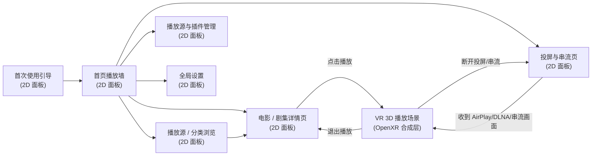

# depth3d 头显端 UI/UX 设计规范

> **适用平台**：PICO 4（Android / OpenXR，单眼 2160×2160，约 20.6 PPD，72/90 Hz，彩色透视）及后续 OpenXR 一体机（Quest 3/3S 等）  
> **适用界面**：2D 悬浮面板（Jetpack Compose） + VR 播放场景内控件（OpenXR Composition Layers）  
> **设计语言**：以海报与画面为主角、深色半透明空间玻璃、大号射线/捏合热区，在真实透视环境中依然清晰易读  
> **规范版本**：v1.0（设计阶段，不修改现有应用代码）

---

## 目录

1. [产品与双端界面边界](#1-产品与双端界面边界)
2. [信息架构与导航设计](#2-信息架构与导航设计)
3. [2D 面板页面布局与状态矩阵](#3-2d-面板页面布局与状态矩阵)
4. [VR 交互与无键盘输入规范](#4-vr-交互与无键盘输入规范)
5. [视觉设计规范（面向透视环境与 PICO 4 光学）](#5-视觉设计规范面向透视环境与-pico-4-光学)
6. [VR 播放场景内控件规范（OpenXR 合成层）](#6-vr-播放场景内控件规范openxr-合成层)

---

## 1. 产品与双端界面边界

depth3d 是一款运行于 PICO 4 上的「2D → 实时 3D 影院」。无论是本机视频、网盘、媒体服务器（Jellyfin/Emby/SMB/WebDAV 等，经由 QuickJS 插件接入），还是电脑串流（Moonlight / depth3d Host）、iPad/iPhone AirPlay 镜像、手机 App DLNA 投屏，进入系统后都会经由实时深度估计与双眼 warp 渲染到悬浮于透视房间或虚拟影厅中的 6DoF 屏幕上。

头显端存在**两种渲染形态迥异的界面**，设计必须严格尊重各自的工程边界：

| 维度 | 2D 悬浮面板（Android Activity） | VR 播放场景内控件（OpenXR Composition Layers） |
|---|---|---|
| **技术实现** | Jetpack Compose，运行于 PICO OS 2D 空间窗口 | 渲染器直接提交 OpenXR `XrCompositionLayerQuad` / `Cylinder`，由 Java Canvas 绘制纹理上传 |
| **典型场景** | 选片、浏览片库、管理播放源与插件、等待投屏/串流连接、全局设置、首次引导 | 观影/串流/投屏进行中的播控、3D 深度调节、屏幕与环境切换、字幕/音轨切换、轻提示 |
| **层数与性能约束** | 自由使用 Compose 组件与滚动容器（但需避免复杂实时模糊导致帧率抖动） | **硬上限 16 个合成层**（PICO 4 与 Quest 3 均强制限制 ≤ 16 层），每个独立 UI 面板/图标组必须尽量合批为单张贴图四边形 |
| **典型观看距离** | 约 **1.6–2.0 m**（PICO 2D 窗口默认尺寸，水平视角约 55°–60°） | 默认 **3.0 m**（`STAND_IN_DISTANCE_M = 3.0f`，默认屏宽 3.0 m，水平视角约 53°），用户可自由推拉至 0.2–8.0 m |
| **视觉衔接原则** | 与播放态共享同一套深海暗墨色板、冰蓝（`#58C4FF`）3D 强调色、胶囊圆角与中文层级，进出播放场景无割裂感 | 尽量克制不遮挡画面；控件平时自动隐去，只在悬停/暂停/主动呼出时浮现 |

### 1.1 双端流转关系



> **关键原则**：**投屏接收服务（AirPlay / DLNA）在 App 启动后可于后台静默待命**（受设置开关控制）。即使当前停留在首页或详情页，只要手机发起投屏推送，顶部可弹出轻量通知条「收到来自 iPhone 的投屏，是否立即进入 3D 播放」，避免用户每次都要手动切到投屏页才能接收。

---

## 2. 信息架构与导航设计

### 2.1 一级导航结构（左侧空间导航轨）

在 VR 2D 宽屏面板（16:9，参考画布 **1280 × 720 dp**）中，**采用左侧悬浮半透明导航栏（Navigation Rail / Sidebar）**，而非底部 Tab 栏：

- **原因 1（符合 VR 人体工学）**：人眼与手柄射线在水平扫描时最轻松，左侧固定窄轨（宽 `224 dp`，可收起或保持常驻图标+文字）不侵占海报墙最宝贵的纵向展示高度。
- **原因 2（对齐 Apple TV / Infuse 空间观感）**：内容区向右自然延展，形成「左侧索引 + 右侧宽幅沉浸海报流」的经典影院比例。
- **原因 3（低层级深度）**：将最高频的 5 个顶层域放在一级导航，减少 VR 中层层跳转与频繁返回。

一级导航由上至下分为 **核心入口** 与 **底部工具**：

| 位置 | 导航项 | 职责与核心内容 |
|---|---|---|
| **主导航 1** | **首页**（播放墙） | 精选 Hero 横幅、跨源统一的「继续观看」、跨源「最近添加」、各播放源的横向海报分区 |
| **主导航 2** | **片库**（播放源与分类） | 顶部按播放源切换（全部片库 / 本机视频 / Jellyfin / Mac 网盘 / SMB 等），下钻「电影 / 剧集 / 收藏 / 文件夹」分类网格 |
| **主导航 3** | **投屏与串流** | 统一承载「无线接收（AirPlay 镜像 / DLNA 投屏 / 安卓镜像）」与「电脑串流（Mac depth3d Host / Moonlight）」，将所有“实时画面输入”收口到一处 |
| **主导航 4** | **搜索** | 跨播放源聚合搜索（支持语音、手机扫码输入、热门筛选芯片：类型 / 年份 / 3D 原生片源） |
| **底部工具 1** | **播放源与插件** | 添加/编辑播放源、管理内置与 QuickJS 第三方插件、插件仓库安装与权限查看、TMDB 刮削管理 |
| **底部工具 2** | **设置** | 全局 3D 默认参数、播放与字幕、空间屏幕与环境、投屏接收与手机遥控、隐私与开源信息 |

> **为什么把「投屏接收」和「电脑串流」合并为一个一级入口「投屏与串流」，而不是塞进播放源或藏在设置里？**  
> 播放墙面向的是**点播型媒体库（Source → Category → Item）**；而 AirPlay、DLNA、Moonlight/Sunshine 面向的是**即时画面输入（把另一台设备正在放的画面拉进头显转 3D）**。两者用户心智截然不同：用户拿起 iPad 或想连 Mac 玩游戏时，需要在一级导航一眼看到入口，点进去立即看到设备名/连接状态或已发现的电脑，一步起播。同时在首页顶部右上角放置一个轻量的**状态胶囊**（如 `投屏待命 · depth3d-PICO4` 或 `发现 Mac`），提供一键直达快捷入口。

### 2.2 完整信息架构树

```text
depth3d（头显端）
├── [首次启动] 首次使用引导（透视确认 → 接入内容/试投屏 → 3D 舒适度）
├── 首页（播放墙）
│   ├── 顶部快捷栏（搜索快捷触发 / 投屏待命状态胶囊 / 手机遥控二维码快捷入口）
│   ├── 精选焦点横幅（最近在看或新入库的高清剧照，一键「继续 3D 播放」/「查看详情」）
│   ├── 继续观看（跨播放源统一，来自本地 Room 数据库，带进度条与残余时长）
│   ├── 最近添加（跨播放源聚合）
│   └── 各播放源分区（每个 Source 渲染 1~2 行横向海报，行尾提供「查看全部 →」进入对应播放源页）
├── 片库（按播放源与分类浏览）
│   ├── 播放源切换条（全部 / 本机视频 / 我的 Jellyfin / Google Drive / 客厅 NAS ...）
│   ├── 分类筛选条（电影 / 剧集 / 收藏 / 文件夹 / 原生 3D）+ 排序（最近添加 / 评分 / 名称）
│   └── 海报网格 / 文件夹列表（文件夹支持面包屑导航）
│       └── 详情页
│           ├── 电影详情（主播放 / 版本选择 / 音轨与字幕 / 本片 3D 预设与精调 / 简介 / 相关推荐）
│           └── 剧集详情（继续播放 SxEy / 季选择标签 / 剧集卡片列表 / 音轨与字幕 / 本剧 3D 记忆）
│               └── [全屏进入 OpenXR 3D 播放场景]
├── 投屏与串流
│   ├── Tab 1：投屏接收（iPad/iPhone AirPlay 镜像 · 手机 App DLNA 投屏 · 安卓镜像，展示设备名、Wi-Fi、运行状态与分步图示）
│   └── Tab 2：电脑串流（自动发现 Mac depth3d Host 一键配对 + Sunshine/Moonlight 手动添加主机 + 串流画质预设）
├── 搜索
│   └── 语音按钮 + 手机扫码输入卡片 + 筛选标签（无须盲打键盘）+ 跨源结果分组
├── 播放源与插件
│   ├── Tab 1：我的播放源（列表、在线/离线状态、片库数、刮削进度、刷新/编辑/移除、添加播放源向导）
│   ├── Tab 2：插件管理（内置插件、已安装第三方 QuickJS 插件、权限白名单徽章、更新/停用、动态配置表单）
│   └── Tab 3：插件仓库（添加仓库 JSON 地址（支持扫码）、浏览可用插件、一键安装）
└── 设置
    ├── 3D 与画面（全局默认分离度、汇聚距离、原生 3D 自动识别、画质默认）
    ├── 播放与字幕（ExoPlayer 硬件解码、默认语言、字幕字号与默认空间深度、片尾自动连播）
    ├── 空间与环境（默认背景：透视/影院、屏幕位置按场景记忆、进入播放自动居中）
    ├── 投屏与遥控（设备名称修改、后台静默接收 AirPlay/DLNA、局域网网页遥控开关与端口）
    ├── 媒体库与刮削（TMDB 刮削开关与 API 配置、缓存清理）
    └── 关于与诊断（版本、自动更新、崩溃日志上报[默认关]、GPLv3 许可证与源码地址）
```

### 2.3 核心用户路径与层级限制

- **最快起播路径（1 次点击）**：打开 App → 首页「继续观看」点击封面右上角或整卡 → 直接进入 3D 播放（或进入详情页后 1 击播放；建议「继续观看」整卡点击直接续播，右上角 `···` 图标或长按进入详情页，最大化爽感；普通海报点击进入详情页）。
- **页面栈深度控制**：2D 面板内页面跳转不超过 **3 层**（例如：`首页 → 片库/文件夹 → 详情页`）。左上角永远提供大号 `← 返回` 按钮（`60 × 52 dp`），同时兼容手柄 B 键 / 返回手势。

---

## 3. 2D 面板页面布局与状态矩阵

所有 2D 面板以 **1280 × 720 dp**（16:9）为基准设计尺寸，左右安全边距 `32 dp`，内容区宽 `1056 dp`（扣除左侧 `224 dp` 导航轨）。当用户拖拽调整 PICO 窗口比例时，海报列数自适应（4~6 列），字体与最小触控尺寸不缩小。

### 3.1 首页播放墙（`01-home.html`）

**布局结构**：
1. **顶部轻状态栏（高 `64 dp`）**：左侧为页面问候/标题或当前聚焦提示，右侧为「投屏待命 · depth3d-PICO4」状态胶囊（绿点脉冲，点按直达投屏页）与「手机遥控」二维码按钮。
2. **Hero 焦点大卡（高 `248 dp`，圆角 `24 dp`）**：展示最近未看完的大片或新入库高分影片的横版剧照（16:9 渐变过渡至左侧深色遮罩），左侧呈现片名、元数据（年份 · 时长 · 分辨率 · `实时 3D` 或 `原生 SBS` 徽章）、1–2 行简介、主按钮「继续播放（剩余 42 分钟）」和次按钮「查看详情」。
3. **继续观看行（横向卡片，16:9 宽 `260 × 146 dp`）**：区别于普通海报的 2:3 竖版，采用 16:9 剧照卡体现“正在播放的画面感”，底部叠加高对比度冰蓝进度条（高 `6 dp`），标注来源角标（如 `Jellyfin` / `网盘`）与集数/剩余时间。
4. **最近添加 & 各播放源海报行（竖版 2:3 海报，宽 `164 × 246 dp`）**：行标题带播放源图标和片数，右侧提供大号「查看全部 →」按钮；行左右两端在可滚动时浮现大号半透明翻页箭（`56 × 56 dp`），解决 VR 射线横滑不便的问题。

**状态矩阵**：

| 状态 | 界面表现与引导 |
|---|---|
| **正常态** | Hero + 继续观看（无记录时隐藏此行）+ 最近添加 + 各启用播放源分区 |
| **首次无片源 / 空状态** | 隐藏空海报行，主体呈现居中「开始组建你的 3D 影院」空态引导卡，提供 3 个等权重行动卡片：① 扫描本机视频 / 授予存储权限；② 添加网盘、Jellyfin 或安装插件；③ 先用手机/iPad 投屏体验 3D |
| **加载态（首屏/刷新）** | 保持固定卡片骨架屏（深灰微光脉冲占位，避免加载完版面剧烈跳动引起眩晕） |
| **部分播放源离线/出错** | **不阻塞整页**；仅在对应播放源分区标题旁显示琥珀色离线胶囊（如 `Mac 网盘 · 未连接`），该行内展示横向错误提示条「无法连接到 192.168.1.10 · 请确认 Mac 上的 depth3d Host 已运行」+ `重试` / `检查配置` 两个按钮 |
| **本地无存储权限** | 「本机视频」分区替换为权限引导条「需要媒体访问权限以扫描本机视频」+ `立即授权` 按钮 |

### 3.2 详情页 — 电影与剧集（`02-detail-movie.html`、`03-detail-series.html`）

**布局结构**：
- **背景层**：顶部 `45%` 高度铺展影片 Backdrop 横图，向下和向左平滑过渡至 `#0B0E14` 深底色，确保文字区对比度恒定 ≥ 10:1。
- **顶部操作栏**：大号 `← 返回` 按钮，右侧展示所属播放源胶囊（如 `来自：我的 Jellyfin`）与 `收藏` 心形按钮。
- **主信息区（左右分栏）**：
  - 电影：左侧 2:3 精致海报（`220 × 330 dp`），右侧呈现中文标题、副标题/英文原名、元数据徽章（`2025`、`2 小时 18 分`、`4K HDR`、`杜比 5.1`、`实时 3D` / `原生 3D`）。
  - **主操作行**：超大主 CTA 按钮（`高 64 dp`，宽 ≥ `240 dp`）：`▶ 3D 播放`（或 `▶ 继续播放 00:46:12`），旁边配 `从头播放`（有进度时）、`2D 播放` 或 `3D 参数` 快捷胶囊。
  - **播放选项条（内联可点胶囊，免进二级菜单）**：
    - `版本`（如 `4K HEVC · 24.6 Mbps` / `1080p` — 多版本时显示）
    - `音轨`（如 `国语 Dolby 5.1`）
    - `字幕`（如 `简体中文 · 特效 ASS`）
    - `本片 3D 设置`（独立记住每部片的设置：`自动实时 3D · 均衡 0.6% · 汇聚 0.35`；点开底部浮层可预览/修改强度、汇聚或切换为原生 SBS/OU/关闭）
- **剧集专属结构（`03-detail-series.html`）**：
  - 主 CTA 清晰标注当前续播集数，如 `▶ 继续播放 · 第 2 季 第 4 集`。
  - **季选择器**：横向大号胶囊 Tabs（`第 1 季 (10集)`、`第 2 季 (8集)`、`特别篇`），单按钮高 `52 dp`，选中态冰蓝高亮。
  - **剧集列表**：采用 2 列或 3 列宽幅剧集卡片（每卡含 16:9 单集缩略图 + 底部进度条 + `E04` 编号 + 单集标题 + 时长 + 简介摘要 + 已看完对勾徽章），避免在 VR 里扫描过长的单行细文字列表。

**状态矩阵**：

| 状态 | 界面表现 |
|---|---|
| **加载详情中** | 若从海报墙点击进入，立即复用卡片已有的海报与标题，其余元数据和剧集列表用骨架块填充 |
| **无刮削元数据（纯文件/文件夹视频）** | 隐藏空简介与评分；用视频帧缩略图替代海报，清晰展示文件名、文件路径、分辨率、码率、编码与文件大小，并提供 `手动匹配影片信息` 按钮 |
| **多集加载失败 / 播放地址获取失败** | 弹出非阻塞内联错误卡，显示具体插件返回原因（如「Jellyfin 登录已过期」或「WebDAV 401 认证失败」）与 `重试` / `重新配置播放源` 按钮 |

### 3.3 播放源与插件管理（`04-sources-plugins.html`）

严格映射 `docs/product-plan.md` 第 2.4 节的数据模型与 QuickJS 插件机制：

**顶部三段分段切换器（Segmented Control，高 `56 dp`）**：
1. **我的播放源**：
   - 展示所有已创建的 `Source` 实例卡片（图标、自定义名称、对应插件类型、地址/路径、状态灯：在线/扫描中/离线、收录条数、刮削开关）。
   - 顶部右侧大号主按钮 `+ 添加播放源` → 弹出引导弹窗：先选自动发现的局域网设备（如 `MacBook Pro · depth3d Host`、`客厅 Jellyfin`），或按已装插件类型新建（WebDAV / SMB / Jellyfin / Emby / DLNA 媒体库）。
   - **配置表单（由插件 `manifest.json` 自动渲染）**：支持文本项、密码项、开关项、下拉项；针对所有文本/URL/密码输入框，右侧统一附带**「手机扫码填写」**快捷条，彻底规避 VR 内输密码和长 URL 的痛苦。
2. **插件管理**：
   - 分为「内置插件」（本机视频、depth3d Host、WebDAV、SMB、Jellyfin/Emby、DLNA 浏览）与「第三方插件（QuickJS 沙箱）」。
   - 每个插件卡片明确展示：名称、版本号、能力标签（`首页` / `搜索` / `进度同步`）、**权限白名单徽章**（如 `仅限局域网`、`域名：*.tmdb.org`、`无文件读写权限` — 透明建立安全信任）、启用/停用大开关、更新按钮、配置按钮。
3. **插件仓库**：
   - 管理插件索引源 JSON URL，提供「扫码添加仓库地址」与预设示例说明；列出仓库中的插件并支持一键安装/更新。

**状态矩阵**：

| 状态 | 界面表现 |
|---|---|
| **无外部播放源** | 保留内置「本机视频」，下方展示大号虚线添加卡「连接你的媒体服务器或网盘」，并高亮局域网自动发现结果 |
| **插件仓库为空** | 清晰说明插件仓库是什么（社区提供的 JSON 索引地址），提供「手机扫码粘贴仓库地址」主按钮与「查看开发文档」二维码 |
| **插件加载/解析出错** | 在该插件卡片标红「运行异常」，附 `查看日志` 与 `停用插件` 按钮，**绝不拖垮整个 App 首页** |
| **TMDB 刮削进行中** | 顶部出现非阻塞进度条「正在识别影片信息 42/128 · 客厅 NAS」，可随时暂停 |

### 3.4 投屏接收与电脑串流（`05-cast-stream.html`）

**顶部双 Tab 切换**：`无线投屏接收` | `电脑串流（Moonlight / Host）`

#### Tab 1：无线投屏接收（重点页面）
- **顶部设备身份卡（核心信息一眼看清）**：
  - 左侧：柔和脉冲波纹动画图标 + 大号本机投屏名称 **`depth3d-PICO4`**（字号 `36 sp`，旁边有 `改名` 按钮）+ 实时状态徽章 `● 正在等待连接` + 当前 Wi-Fi 名称与局域网 IP（如 `Wi-Fi: Studio_5G · 192.168.1.24`）。
  - 右侧：服务总开关（AirPlay 镜像 / DLNA 投屏独立小开关，均默认开）+ **重要提示**：「请确保手机/iPad 与头显连接同一 Wi-Fi」。
- **三种投屏方式引导卡（三栏横向排布，图文步骤清晰，大号易读）**：
  1. **iPad / iPhone 屏幕镜像（AirPlay）**：
     - 步骤 1：从屏幕右上角下滑打开「控制中心」
     - 步骤 2：轻点「屏幕镜像」
     - 步骤 3：选择 **`depth3d-PICO4`**，画面自动全屏转 3D
     - 底部小注：支持整屏镜像（含视频、游戏、网页）；暂不支持 App 内 AirPlay 2 单独推流
  2. **手机视频 App 投屏（DLNA）**：
     - 步骤 1：打开 B 站、爱奇艺、优酷、腾讯视频等 App 播放视频
     - 步骤 2：点击画面右上角「TV 投屏」按钮
     - 步骤 3：选择 **`depth3d-PICO4`**，支持在手机或头显双向控进度
     - 底部小注：iOS 与安卓手机均适用，画质与流畅度最佳
  3. **安卓手机整屏镜像**：
     - 展示轻量「depth3d 镜像发送端」二维码（手机扫码下载/配对）与配对码，连接后推送整屏画面并实时转 3D
- **底部辅助条**：内嵌「手机网页遥控器」快捷卡片（显示二维码与地址 `http://192.168.1.24:8765`，朋友可用手机帮戴头显的你选片或粘贴播放链接）。

**状态矩阵（投屏页）**：
- **等待连接（默认）**：柔和雷达呼吸动效，文字「等待设备连接… 收到画面后将自动进入 3D 影院」。
- **正在握手 / 缓冲**：卡片中心切换为「已连接：小林的 iPad Pro · 正在启动 3D 渲染…」。
- **Wi-Fi 未连接**：顶部身份卡变琥珀色警示「未连接 Wi-Fi · 投屏服务已暂停」+ `打开系统网络设置` 按钮。
- **端口/服务异常**：显示具体失败项（如「AirPlay 服务启动失败，DLNA 正常」）+ `重启接收服务` 按钮。

#### Tab 2：电脑串流
- **自动发现区**：实时通过 Bonjour 扫描局域网 Mac（`depth3d Host`）与 Sunshine 主机。
  - 已配对主机卡片：大号「立即 3D 串流」按钮 + 桌面/应用快捷启动 + 预设分辨率与帧率（如 `1440p · 72Hz · 实时 3D`）。
  - 未配对 `depth3d Host` 卡片：提示「点击后在 Mac 菜单栏点允许即可自动配对，无需输 PIN」。
  - 未配对上游 Sunshine 主机：点击后在卡片内弹出大号 **4 位数字 PIN**（字号 `48 sp`，等宽），下方写明「请在电脑 Sunshine 管理页输入上方 PIN」。
- **未发现电脑空状态**：展示 Mac 安装 `depth3d Host` 的引导卡片（含下载二维码）与 `手动添加 IP`（支持手机扫码输入）。

### 3.5 首次使用引导（`06-onboarding.html`）

严格控制在 **3 步以内**，每步都能在 5–10 秒内通过单次点击完成，且右上角始终提供 `跳过引导`：

1. **Step 1 · 欢迎来到 depth3d**：
   - 简短传达核心价值：「任何 2D 画面，即刻变为悬浮在你身边的立体 3D 影院」。
   - 简明图解两种操控方式（手柄射线+扳机 / 裸手捏合点击）与透视安全提示（确认周围无障碍物）。
   - 主按钮：`开始设置`。
2. **Step 2 · 接入你的第一个内容源**：
   - 后台自动并行扫描：① 本机视频数（如「发现 6 个本机视频，授权即可观看」）；② 局域网是否已运行 Mac `depth3d Host` 或 Jellyfin（如「发现客厅的 MacBook Pro」）。
   - 提供 4 张直观选项卡（可单选或直达）：
     - `授权读取本机视频`
     - `连接发现的 Mac（depth3d Host）` / `没有 Mac Host？查看安装方式`
     - `连接网盘 / Jellyfin / 媒体库`
     - `先用手机 / iPad 投屏试试看`
3. **Step 3 · 选择你的默认 3D 舒适度**：
   - 3 张大卡片并排选择默认 3D 强度：**舒适（0.4%，适合长时间观影与初次体验）** / **均衡（0.6%，推荐，立体感与舒适度平衡）** / **强烈（0.9%，更强景深出屏感）**，附注「播放中随时可一键调整或切回 2D」。
   - 主按钮：`进入 depth3d 影院`。

### 3.6 全局设置页（`07-settings.html`）

采用经典**左右双栏（左侧分类目录宽 `260 dp` + 右侧分组设置项）**，严禁复杂嵌套弹窗：
- **3D 与画面**：默认 3D 开关、强度预设（舒适/均衡/强烈）、默认分离度/汇聚距离微调、原生 3D（SBS/OU/空间视频/180°/360°）自动识别开关。
- **播放与字幕**：默认播放引擎参数、默认音轨/字幕语言、字幕字号、**默认字幕空间深度**（默认略高于画面主平面，防止与立体前景打架）、自动跳过片头/连播下一集。
- **空间与环境**：默认观影环境（透视房间[推荐] / 纯黑影院 / 家庭影院 / 巨幕影厅 / 霓虹赛博）、屏幕位置/大小/曲率按场景自动记忆开关、重置所有屏幕位置。
- **投屏与遥控**：设备名称、后台静默接收 AirPlay 镜像开关、后台静默接收 DLNA 投屏开关、局域网网页遥控服务开关与访问地址。
- **媒体库与插件**：TMDB 自动刮削开关、TMDB API Key（支持扫码填入）、海报缓存占用与一键清理。
- **关于与隐私**：版本号、自动检查更新开关、**匿名崩溃日志上报（默认关闭，明确说明征得同意后开启）**、GPLv3 开源许可与仓库二维码。

---

## 4. VR 交互与无键盘输入规范

### 4.1 交互方式与优先级

PICO 4 用户可能使用 **6DoF 手柄射线**，也可能放下手柄使用 **裸手手势（捏合）** 窝在沙发上看电影。设计必须对两者同等友好：

| 操作 | 手柄方式 | 裸手手势方式 | 备注 |
|---|---|---|---|
| **指向 / 悬停** | 手柄射线指向目标 | 手掌射线指向目标 | 渲染器已做 One-Euro 低通滤波抑抖（`xr_renderer.h`） |
| **点击 / 确认** | 扣动扳机（Trigger） | 食指与拇指轻捏（Pinch） | 释放时触发（松手前移出目标则取消，防误点） |
| **滚动列表 / 海报行** | 摇杆上下/左右推动；或按住扳机拖拽列表 | 捏合按住并上下/左右拖曳；或点击海报行两端大号翻页箭 | **禁止依赖细窄滚动条拖拽**；横向海报行必须配备可点翻页箭 |
| **返回上一页** | 手柄 B 键 / Y 键 / 点左上角 `← 返回` | 点左上角 `← 返回` 按钮 | 所有二级页左上角必有实体返回按钮 |
| **播放快进/快退** | 摇杆左右轻推（±10 秒/格） | 指向进度条捏合并左右拖曳；或点 ±10s 按钮 | 满足产品方案 2.5「补手势拖进度」 |
| **抓取移动/缩放屏幕** | 指向屏幕底边手柄按扳机/侧握键拖拽；抓四角缩放 | 捏住屏幕底边手柄拖动；双手捏合缩放或单手抓角缩放 | 仅在透视/纯黑环境下启用，固定影厅墙面幕布禁用位移 |
| **退出播放** | 播控条「退出」按钮 / 手柄菜单键触发退出确认 | 播控条「退出」按钮 | 串流和长视频退出前弹轻量二次确认（本地短视频或已暂停时可直接退出或单步确认） |

### 4.2 点击目标最小尺寸与热区规则

根据 PICO 4 的光学分辨率（~20.6 PPD）与手部捏合释放时常见的 **0.5°–1.2° 射线偏移**：

| 指标 | 2D 悬浮面板（1280×720 dp，~1.8–2.0 m，约 21.3 dp/°） | VR 播放场景（默认 3.0 m，屏宽 3.0 m，约 5.24 cm/°） | 对应视角 |
|---|---|---|---|
| **最小可点目标（硬底线）** | **48 × 48 dp**（仅限次要辅助按钮，且需向外扩 `8 dp` 不可见热区） | **11 × 11 cm**（约屏宽 3.7%） | **≥ 2.1°–2.25°** |
| **推荐常规按钮 / 列表行高** | **56–64 dp**（高）× **≥ 56 dp**（宽） | **14 × 14 cm**（约屏宽 4.7%，与现有 `ENV_BUTTON_FRAC = 0.048` 一致） | **2.6°–3.0°** |
| **主 CTA 按钮（如「3D 播放」）** | **64 dp 高 × ≥ 200 dp 宽** | 播放条高度 **21–24 cm**（垂直热区额外上下外扩 35%） | **≥ 3.0° 高** |
| **相邻可点目标最小间距** | **12–16 dp**（密集图标组不少于 `12 dp`） | **≥ 3.5 cm**（≥ 0.7°） | **≥ 0.6°–0.75°** |
| **滑块轨道有效拖拽高度** | **48 dp**（视觉轨道高 `8 dp`，但上下热区扩大至 `48 dp`） | **≥ 12 cm**（视觉轨道高 `2 cm`） | **≥ 2.2°** |

> **关键防误触规则（Pinch-Release Stabilization）**：用户开始捏合/扣扳机的瞬间，指针往往会轻微下坠。因此：① 按钮按下瞬间锁定命中目标（允许偏移容差 ±16 dp 内松手依然判定有效）；② 高危操作（删除播放源、清空缓存、中断电脑串流）必须有清晰的二次确认卡片，且确认按钮与取消按钮间隔至少 `24 dp`。

### 4.3 悬停（Hover）、焦点与按下反馈

VR 中没有手指触碰玻璃的物理阻力，必须依靠**清晰、柔和但可立即察觉的视觉 + 轻听觉/触觉反馈**建立空间确定感：

1. **悬停态（Hover）**：
   - **海报/剧集卡片**：外圈浮现 `2 dp` 柔和冰白光环（`rgba(255,255,255,0.72)`）+ 整体平滑微放大 `scale(1.04)`（150ms ease-out）+ 顶部边缘微弱高光掠过；卡片不遮挡相邻卡片文字。
   - **胶囊按钮/导航项**：背景亮度提升一档（如 `rgba(255,255,255,0.08)` → `rgba(255,255,255,0.18)`）+ `1.5 dp` 亮边；图标微放大 `1.08×`。
   - **播放场景内 OpenXR 按钮**：由于单层缩放零纹理上传成本（参考 `xr_layers.c` 第 650 行），或整条重绘高亮色，悬停态统一表现为**冰蓝高亮（`#7FD4FF`）+ 柔和底圈背板**，并在按钮上方显示 2–4 字中文短提示（如 `3D 调节`、`字幕音轨`）。
   - **触觉与音效**：进入新可点目标时触发极轻短滴答声（可于设置关闭，复用 `SETTING_CLICK_SOUND`）与手柄极微弱短震（5ms）。
2. **按下态（Pressed）**：卡片/按钮略微回缩 `scale(0.97)`，高光转为实心强调色。
3. **选中/激活态（Selected / Active）**：使用冰蓝填充基底 `rgba(88, 196, 255, 0.22)` + 左侧/底部高亮指示条或 `1.5 dp` 冰蓝描边（`#58C4FF`），文字升为纯白加粗。
4. **禁用态（Disabled）**：整体不透明度降至 `0.38`，移除悬停放大反馈，且尽可能附带 1 行小字说明原因（如「当前影厅幕布大小固定，不可缩放」）。

### 4.4 无键盘/无鼠标输入策略（Zero-Typing First）

在 PICO 4 里用射线逐字母敲网址、密码或中文片名是极差体验。所有需要文本输入的场景必须遵循**四级降级策略**：

```text
优先级 1：免输入自动发现（Bonjour / mDNS / SSDP 自动扫描 Mac Host、Jellyfin、SMB、WebDAV、DLNA）
   ↓ 无法自动发现时
优先级 2：手机/电脑扫码输入（局域网临时网页伴侣页，手机粘贴 URL/密码/片名，WebSocket 实时回填头显表单）
   ↓ 不方便掏手机时
优先级 3：语音输入 + 快捷筛选标签（搜索页默认给「语音听写」按钮 + 类型/年份/播放源/最近搜索芯片）
   ↓ 最终兜底
优先级 4：PICO 系统虚拟键盘（聚焦输入框时唤起，同时提供常用前缀快捷按钮如 http://、https://、192.168.、:8096）
```

**具体落点**：
- **添加 WebDAV / Jellyfin / 插件仓库 URL / TMDB Key**：表单顶部或右侧常驻「用手机填写更轻松」二维码卡片（显示 `http://<头显IP>:8765/fill`），手机扫码打开网页即与当前头显表单字段实时双向绑定，手机上复制粘贴长 URL 和密码，点「发送到头显」立刻填好。
- **连接 Mac（depth3d Host）**：自动发现后头显点击「配对」，Mac 菜单栏弹窗点「允许」自动完成证书交换，零输入。
- **搜索影片**：打开搜索页直接呈现「按住说片名（语音）」大按钮 +「手机扫码搜片」按钮 + 快捷筛选项，仅在点击搜索框时才弹出系统键盘。

---

## 5. 视觉设计规范（面向透视环境与 PICO 4 光学）

### 5.1 透视环境下的配色原则

depth3d 的默认背景是 **PICO 4 彩色透视真实房间**——用户可能坐在阳光充足的白色客厅，也可能在夜间开台灯的卧室。**普通浅透明毛玻璃在亮客厅里会发灰失真，纯黑不透明窗口又会割裂空间感。**

因此采用**「深海暗墨高对比空间玻璃」**策略：
- **高不透明度深底**：主面板基底采用 `rgba(14, 17, 24, 0.88)`（~88% 不透明度，透视背景仅隐约透出环境光色温，绝不影响任何文字可读性）；卡片与浮层采用 `rgba(26, 31, 44, 0.90)` 与 `rgba(18, 22, 32, 0.94)`。
- **微弱冷白外框 + 顶缘高光**：每个悬浮面板外围保留 `1 dp` 冷白半透明描边（`rgba(255, 255, 255, 0.14)`）和外投影，让面板在暗房与亮房中都有清晰的空间轮廓。
- **克制的 3D 标志色**：保留已有 `TransportBar.java` 的冰蓝色系并做精致提纯——**冰穹蓝 `#58C4FF` / 亮冰蓝 `#7FD4FF`** 作为 depth3d 的品牌与立体感主色（寓意光学深度与清澈），其余区域保持中性冷灰，把色彩舞台让给电影海报与视频画面。

### 5.2 颜色 Token 表

| Token 名称 | 色值（RGBA / Hex） | 用途 | 对比度说明 |
|---|---|---|---|
| `--bg-window` | `rgba(13, 16, 23, 0.88)` | 2D 主窗口基底（透视背景之上） | 与主文字对比度 > 13:1 |
| `--bg-sidebar` | `rgba(9, 12, 18, 0.72)` | 左侧导航轨基底 | 形成自然层次分区 |
| `--bg-surface` | `rgba(28, 34, 48, 0.82)` | 普通卡片、列表项、设置分组底色 | 与窗口底色拉开亮度阶差 |
| `--bg-surface-hover` | `rgba(42, 51, 72, 0.92)` | 射线悬停态底色 | 清晰可辨的悬停反馈 |
| `--bg-elevated` | `rgba(18, 22, 33, 0.94)` | 弹窗、下拉菜单、VR 播放快捷菜单底色 | 覆盖在视频画面上仍高可读 |
| `--bg-transport` | `rgba(14, 17, 24, 0.84)` | OpenXR 底部播放控制条与 Toast 底色 | 较原 `0xC0101014` 更深邃通透 |
| `--border-subtle` | `rgba(255, 255, 255, 0.12)` | 面板外轮廓、卡片默认边框 | 暗环境下定位窗口边界 |
| `--border-hover` | `rgba(255, 255, 255, 0.68)` | 海报/按钮悬停描边 | 射线聚焦一目了然 |
| `--text-primary` | `#F4F7FB` | 标题、正文、按钮主文字（避免纯 `#FFFFFF` 在暗场引起光晕眩光） | 对比度 ≥ 13.5:1 |
| `--text-secondary` | `#A7B4C9` | 副标题、元数据、说明文字 | 对比度 ≥ 7.2:1（AAA） |
| `--text-muted` | `#74839B` | 极次要标签、禁用态提示、占位符 | 仅用于大字号辅助或标签 |
| `--accent-3d` | `#58C4FF` | 主 CTA、选中态、进度条填充、3D 开启标识 | 品牌识别核心色 |
| `--accent-3d-hover` | `#84D6FF` | 主按钮/滑块悬停高亮（延续原 `0xFF7FD4FF`） | |
| `--accent-3d-soft` | `rgba(88, 196, 255, 0.18)` | 导航选中底色、3D 徽章底色 | |
| `--semantic-success` | `#3ED598` | 播放源在线、投屏待命脉冲、已看完勾 | |
| `--semantic-warning` | `#FFB648` | 离线提示、Wi-Fi 异常、高分离度眼疲劳提示 | 超过 1.0% 分离度滑块段标黄 |
| `--semantic-danger` | `#FF6470` | 出错状态、移除/断开危险操作、退出确认 | |

> **光学防眩光细节**：在 PICO 4 的 Pancake 镜片上，高亮度纯白（`#FFFFFF`）大面积色块置于纯黑背景容易产生轻微鬼影（Glare）。因此主文字选用微柔和的 `#F4F7FB`，避免大面积白色卡片，主 CTA 按钮采用中高饱和冰蓝（`#58C4FF` 配深墨字 `#07131D`）或渐变深蓝高亮。

### 5.3 字体与最小可读字号计算（基于 PICO 4 光学）

**光学推导过程**：
1. PICO 4 单眼分辨率 **2160 × 2160**，水平 FOV 约 **104°** → 平均角分辨率 **20.8 PPD**（中心视野约 **21–22 PPD**）。
2. PICO OS 中标准 16:9 2D 悬浮窗口（基准画布 **1280 × 720 dp**）默认占据约 **55°–60° 水平视角**（例如在 2.0 m 处宽约 2.1–2.3 m，或在 1.6 m 处宽约 1.7–1.85 m）→ 换算系数约为 **21.3–23.3 dp/°**，即 **`1 dp ≈ 0.90–0.98` 个物理眼像素**。
3. **简体中文笔画密度要求**：英文拉丁字母在 14–16 物理像素（~0.7°）下尚可辨认，但简体中文常用字（如「瓣」「聚」「幕」「源」）需要 **至少 18 物理像素（≥ 0.85°）** 才不会在 Pancake 镜片与次像素采样下出现笔画粘连，舒适阅读需 **20 物理像素（~0.95°–1.0°）** 以上。
4. **结论**：
   - **中文正文最小可读字号 = `18 sp`**（约 `0.85°` / `17.5–18.5` 物理像素），**推荐正文 `20 sp`**（约 `0.94°` / `19.5` 物理像素）。
   - **绝对下限 = `15–16 sp`**（仅允许用于极短数字、英文技术徽章如 `4K HDR`、`Dolby` 或 2–3 字加粗徽章，且必须 Medium/SemiBold 字重）。**禁止在 VR 2D 面板中使用 ≤ 14 sp 的中文字体。**

**字体族选择**：系统内置无衬线黑体（Android 端 `Noto Sans CJK SC` / 思源黑体，Mac 预览端回退 `PingFang SC` / `Hiragino Sans GB`）；时间码、码率、IP 地址与 PIN 码强制开启等宽数字（`font-variant-numeric: tabular-nums`），避免播放时间跳动抖动。

**2D 面板字号层级表（1280 × 720 dp 基准）**：

| 级别 | 字号 / 行高 | 字重 | 视角（约） | 用途 |
|---|---|---|---|---|
| **Display** | `40 sp` / `48 sp` | Bold (700) | `1.88°` | 详情页主片名、投屏页大号设备名、引导页主标题、串流 PIN 码（`48 sp`） |
| **Title L** | `30 sp` / `38 sp` | Bold (700) | `1.41°` | 页面主标题、Hero 横幅片名 |
| **Title M** | `24 sp` / `32 sp` | SemiBold (600) | `1.13°` | 首页分区标题（继续观看、我的 Jellyfin）、弹窗标题 |
| **Title S** | `20 sp` / `28 sp` | SemiBold (600) | `0.94°` | 卡片主标题、一级导航文字、主按钮文字、设置项名称 |
| **Body** | `18 sp` / `28 sp` | Regular (400) | `0.85°` | 影片简介、引导步骤说明、空状态与错误说明（**中文正文底线**） |
| **Caption / Meta** | `16 sp` / `22 sp` | Medium (500) | `0.75°` | 海报下方副信息（年份/时长/集数）、状态胶囊、辅助标签 |
| **Micro Badge** | `14–15 sp` / `18 sp` | Bold (700) | `0.68°` | 仅限极短英文/数字角标（`4K`、`HDR`、`3D`、`SBS`、`ASS`），不放中文长句 |

**VR 播放场景字号换算（默认 3.0 m 观看距离，1° ≈ 5.24 cm）**：
- 控制条时间码：目标视角 `1.2°–1.35°`（约 `6.5 cm` 高，在 `1920 × 152` 播控条贴图中对应 `44–48 px` 字号，清晰无糊边）。
- 快捷菜单标题 / 选项标签：目标视角 `1.0°–1.2°`（面板宽 `1.25 m` @ 3.0 m，贴图 `1024 × 720`，对应 `34–40 px` 字号；副说明最小 `28 px` ≈ `0.85°`）。
- Toast 提示文字：位于眼前 `0.80 m` 或屏前 `2.8 m`，目标视角 `1.2°–1.4°`，保证余光一扫即懂。

### 5.4 圆角、间距与动效

- **间距系统**：基于 **8 dp** 网格（`8 / 12 / 16 / 24 / 32 / 40 dp`）。页面边距 `32 dp`，分区垂直间距 `32 dp`，卡片间距 `16–20 dp`。
- **圆角体系**：
  - 2D 顶层窗口容器：`28 dp`
  - 大型卡片（Hero / 引导卡 / 弹窗 / VR 快捷菜单）：`20–24 dp`
  - 海报与剧集卡片：`14–16 dp`（图片与容器同心圆角）
  - 按钮、Tab、输入栏、状态胶囊：`12–14 dp` 或全胶囊 `999 dp`
  - 技术角标（`4K`、`3D`）：`6–8 dp`
- **VR 友好动效规则（防晕动症）**：
  - **快而克制**：悬停反馈 `120–150 ms`（`cubic-bezier(0.2, 0.8, 0.2, 1)`）；面板淡入淡出 `180–220 ms`。
  - **禁止全屏滑动/弹跳/视差倾斜**：VR 中整屏横向平移动画或大幅度缩放易诱发不适。页面切换采用**柔和透明度交叉淡入（Cross-fade）**，弹窗仅做 `0.96 → 1.0` 微缩与透明度变化。
  - **禁止持续高频闪烁**：加载骨架屏与投屏待命波纹周期应 ≥ `1.8 s` 且亮度变化幅度克制。

---

## 6. VR 播放场景内控件规范（OpenXR 合成层）

### 6.1 OpenXR 16 层硬限制与层预算表

由代码分析（`xr_layers.c`）可知，PICO 4 与 Quest 3 运行时强制限制单帧最多 **16 个合成层**，超出将触发丢帧或帧被拒收。

**核心设计决策：整面板合批绘制（Texture Atlas / Single-Quad Sheet）**  
放弃 MoonlightXR 早期“一个按钮占一个 Quad 层”的做法（原底部工具栏 7~8 个按钮就要吃掉 8 层），将整个底部播控条合并为 **1 张高分 Canvas 贴图四边形**，将快捷菜单合并为 **1 张主面板贴图 + 1 张动态滑块/悬停高亮层（或直接局部重绘合并为 1 层）**。

| 序号 | 合成层（OpenXR Layer） | 类型 | 是否常驻 | 层数占用 | 说明与优化策略 |
|---|---|---|---|---|---|
| 1 | 虚拟影院环境（Room） | `Projection` | 仅影厅模式 | 0 或 1 | 透视模式与纯黑模式为 **0 层** |
| 2 | 氛围光（Ambilight Glow） | `Quad / Cylinder` | 可选 | 0 或 1 | 屏幕背后的动态泛光 |
| 3 | 视频主画面（左眼 + 右眼） | `Quad / Cylinder` × 2 | 常驻 | **2**（2D 时为 1） | 3D 实时/原生立体画面核心层 |
| 4 | 空间立体字幕（Subtitle） | `Quad` | 有字幕时 | **1**（双目视差深度可设为 2） | 置于画面前方匹配深度，无字幕时为 0 |
| 5 | **底部播放控制条（Transport Bar）** | `Quad` | 悬停/暂停时 | 0 或 **1** | **合批 1 层**：含播/停、±10s、进度条、时间、右侧 5 个快捷功能键与退出键 |
| 6 | **快捷菜单主面板（Quick Menu）** | `Quad` | 呼出时（互斥） | 0 或 **1** | **合批 1 层**：4 个功能 Tab（3D / 屏幕与环境 / 字幕音轨 / 更多），与拖拽手柄互斥 |
| 7 | 快捷菜单悬停/滑块高亮层（可选） | `Quad` | 快捷菜单打开时 | 0 或 **1** | 用于零成本拖动滑块圆点；若直接重绘面板则可省为 0 |
| 8 | 屏幕移动手柄 / 缩放角标 | `Quad` | 悬停底边/四角时 | 0 或 **1** | 快捷菜单打开时自动隐藏（互斥） |
| 9 | 射线光束 + 光标点 | `Quad` × 2 | 指向时 | 0 或 **2** | 手柄静置 5 秒自动休眠消失 |
| 10 | 顶部轻提示 Toast | `Quad` | 瞬态（2.5–3s） | 0 或 **1** | 3D 开关、快进退、缓冲、手势提示等 |
| 11 | 性能统计 / 手柄 3D 模型（可选） | `Quad` / `Projection` | 调试/可选 | 0~2 | 超预算时优先按序降级裁剪 |
| **合计** | **最重峰值（影厅 + 泛光 + 3D双目 + 立体字幕 + 播控条 + 快捷菜单 + 射线光标 + Toast）** | | | **11 层**（双目字幕 12 层） | **安全低于 16 层硬上限，保留 4–5 层安全余量！** |

> **超预算自动裁剪优先级**（沿用并扩展 `xr_layers.c` 机制）：① 隐藏手柄 3D 模型 → ② 隐藏统计层 → ③ 合并快捷菜单滑块层到主画布重绘 → ④ 暂时隐藏氛围光，**永远保证视频双眼、字幕、播控条与快捷菜单本身不被裁剪**。

### 6.2 底部播放控制条（升级版 `TransportBar`）

在现有 `TransportBar.java`（1536×112，仅播放/时间/进度条）的基础上，重构为**双行紧凑悬浮胶囊条**（建议贴图尺寸 **`1920 × 176 px`**，位于画面底部外沿下方或画面底缘上方 `0.02 × screenWidth` 处，Z 轴前移 `0.015 m` 避免与画面 Z-fighting）：

- **上方信息微条（高度 `48 px`，暂停或悬停进度条时淡入）**：
  - 左侧：当前片名（如 `星尘摆渡人 · 第 1 季 第 4 集`）+ 来源小标签（如 `Jellyfin`）。
  - 右侧：实时状态胶囊（`实时 3D · 均衡`、系统时间 `21:42`、头显电量 `78%`），无需摘头显看时间电量。
- **主控制胶囊（高度 `116 px`，圆角 `58 px`，底色 `rgba(14, 17, 24, 0.86)` + `1.5 px` 亮边）**：
  - **左区（播放控制）**：`退 10 秒` | **`播放/暂停`（大圆形主按钮）** | `进 10 秒`（剧集且有多集时，长按或右侧可扩展 `下一集` 按钮）
  - **中区（时间轴）**：`已播时间 00:46:12` — **高对比度冰蓝进度轨道（含缓冲段）** — `总时长 02:18:30`
    - 射线悬停轨道任意位置时，光标处立起白色竖线，轨道正上方弹出**悬浮预览气泡**（显示目标时间如 `01:12:40`，未来支持缩略图）
    - 扣扳机立即跳转；**支持捏合并左右拖动进度条（手势拖进度）**，松手确认跳转
  - **右区（快捷工具图标组，间距充裕，每个热区 ≥ 2.5°）**：
    - **`3D` 切换键**：一键开关实时 3D（冰蓝亮起 = 3D 开启，灰白 = 2D），悬停提示「3D 开关 / 菜单里调强度」
    - **`字幕/音轨` 图标**：直接打开快捷菜单并定位到「字幕与音轨」Tab
    - **`环境/屏幕` 图标**：直接打开快捷菜单并定位到「屏幕与环境」Tab
    - **`设置/快捷菜单` 图标（☰ / 滑块图标）**：打开快捷菜单（记住上次 Tab，默认「3D 调节」）
    - **`退出` 图标（← / ×）**：退出播放返回 2D 面板（串流时弹二次确认）

#### 出现与消失规则（严格克制不打扰观影）

| 触发事件 | 控制条行为 |
|---|---|
| **进入播放开始** | 显示 `3.0 秒` 后自动淡出（200ms） |
| **播放中静止看片** | 完全隐藏（0 层渲染，画面纯净） |
| **手柄/手部移动且射线落入画面或底部区域** | 移动位移超过防抖阈值（沿用 `LocalPlayerXR.java` 的 `> 0.004` 归一化位移）立即淡入；射线移出控制条且停止移动 **`3.0 秒`** 后自动淡出 |
| **射线停留在控制条或快捷菜单上** | **保持常驻不自动消失**（避免用户读字幕选项时面板突然消失！） |
| **暂停状态** | 控制条**保持常驻**，同时显示上方片名与时间电量；恢复播放 `2.0 秒` 后若射线不在条上则淡出 |
| **摇杆左右快进/快退** | 立即唤醒控制条并高亮新进度点，操作结束后停留 `2.5 秒` 淡出 |
| **画面空白处单击扳机/捏合** | 若快捷菜单打开 → 关闭快捷菜单；否则切换「播放 / 暂停」 |

> **关键优化（相比旧版 `TransportBar`）**：旧版 `LocalPlayerXR.java` 只要 3 秒没动指针就会隐藏控制条，即便指针正好停在按钮上。新版规范要求**只要射线悬停在控制条或快捷菜单热区内，倒计时暂停，绝不中途隐藏**。

### 6.3 播放中快捷菜单（Quick Menu）

**呼出方式**：
1. 点击控制条右侧对应的快捷图标（`3D` 详情 / `字幕音轨` / `屏幕环境` / `快捷菜单`），直接展开并落到相应 Tab。
2. 快捷键：手柄菜单键（或裸手双击非画面区 / 控制条 `☰`）。

**空间锚定原则（极其重要）**：
- 菜单浮现在**控制条正上方偏右或居中位置**，宽约 `1.25 m`（@ 3.0 m，约 `23.5°` 宽），高约 `0.88 m`，Z 轴位于屏幕前方 `0.06 m`。
- **打开即冻结空间位姿（Pose Freeze）**：沿用 `xr_ui.c` 中 `cogPanelPose` 的优秀设计——当用户在「屏幕与环境」里拖动屏幕距离、高度或大小滑块时，**快捷菜单本身留在原位不动**，防止滑块从射线底下逃走！关闭菜单后下次打开再按新屏幕位置重新锚定。
- **半透明不完全遮挡画面**：尺寸克制（占主画面宽度约 `38%–42%`），偏置在画面下方或右侧区域，让用户调整 3D 强度、画面亮度、字幕深度时**实时用余光或主视野直接看到画面变化**。

**四大 Tab 内容规划（每页不超过 5–6 行，确保热区宽松不拥挤）**：

| Tab | 包含控件 | 说明 |
|---|---|---|
| **1. 3D 深度** | ① 实时 3D 总开关（开 / 关）<br/>② 强度预设三选一：**舒适 (0.4%) / 均衡 (0.6%) / 强烈 (0.9%)**<br/>③ 精细分离度滑块（`0.0% ~ 1.5%`，步进 `0.1%`；超过 `1.0%` 轨道末段标琥珀色护眼警示）<br/>④ 汇聚距离（出屏/入屏）滑块（`0.0 ~ 1.0`，默认 `0.35`）<br/>⑤ 片源格式：自动实时 3D / 原生左右 SBS / 原生上下 OU / 180° / 360°<br/>⑥ 底部按钮：`保存为本片记忆` · `恢复默认` | 任何拖动均毫秒级实时生效 |
| **2. 屏幕与环境** | ① 观影环境 5 选 1 缩略图行：**透视房间（默认）** / 纯黑影院 / 家庭影院 / 巨幕影厅 / 霓虹赛博<br/>② 屏幕大小滑块（`0.8 m ~ 8.0 m`，固定幕布影厅灰显并说明）<br/>③ 观看距离滑块（`0.5 m ~ 6.0 m`，影厅模式替换为「影厅亮度」）<br/>④ 曲面曲率滑块（`平面 ~ 环绕`）<br/>⑤ 视角模式：`空间固定 6DoF` / `跟随头部（躺看模式）` + `氛围光开关`<br/>⑥ 底部按钮：`重置屏幕到眼前` | 透视/影厅动态切换对应行（如影厅下自动将距离/曲率切换为影厅亮度与屏幕反光，复用 `xr_ui.c` Room 逻辑） |
| **3. 字幕与音轨** | ① 音轨选择列表（单选胶囊，标注语言与声道，如 `国语 · 5.1`、`英语 · Atmos`）<br/>② 字幕选择列表（`关闭` + 内封/外挂字幕列表，标注格式如 `简中 ASS`）<br/>③ **字幕空间深度滑块**（`紧贴屏幕` ↔ `适中前置[推荐]` ↔ `更靠前`，解决 3D 画面里字幕与前景人物深度打架重影的核心痛点！）<br/>④ 字幕字号（`小 / 中 / 大`）与延迟微调（`-0.5s / 0 / +0.5s`） | 串流/纯镜像模式下隐藏本 Tab，替换为「画面与操控」 |
| **4. 播放辅助** | ① 播放倍速（`0.5x / 0.75x / 1.0x / 1.25x / 1.5x / 2.0x`）<br/>② A-B 区间重复（`设起点 A` → `设终点 B` → `清除`）<br/>③ 睡眠定时（`关闭 / 15 分 / 30 分 / 60 分 / 播完本集`）<br/>④ 画面微调入口（亮度 / 对比度 / 饱和度）<br/>⑤ 性能诊断 HUD 开关（FPS / 深度推理耗时，默认关） | 收纳低频但实用的影院工具，不污染主播控条 |

### 6.4 串流与投屏模式下的播放界面差异

当播放来源为 **电脑串流（Moonlight / Host）**、**AirPlay 镜像** 或 **安卓镜像**（无时间轴的实时流）时，OpenXR 播放控件自动适配：
- **隐藏进度条、±10s、倍速、A-B 重复、字幕/音轨 Tab**。
- 底部条收敛为紧凑胶囊（宽约画面 `48%`），只保留：当前来源名称（如 `MacBook Pro · 串流中` 或 `小林的 iPad Pro · AirPlay 镜像`）+ 实时延迟/帧率微标 + **`3D 开关`** + **`环境/屏幕`** + **`快捷菜单`** +（仅电脑串流时显示：`虚拟键盘`、`手柄/指针模式切换`）+ **`断开连接`**。
- **DLNA 推送视频**（本质是 ExoPlayer 播 URL）：**保留完整进度条与播放/暂停/倍速**，并双向同步进度回手机 App。

### 6.5 空间屏幕直接操控（6DoF）

当处于**透视房间**或**纯黑影院**时，用户无需打开菜单即可直接调整屏幕：
- **底边拖拽手柄**：当射线滑到屏幕下边缘外侧（未进入控制条按键区时），浮现一条简洁的白色半透明胶囊握把（宽约屏宽 `14%`，复用 `BAR_WIDTH_FRAC`）；按住扳机/捏合并拖动即可在 6DoF 空间自由移动屏幕，同时推送摇杆前后可顺手推远/拉近距离！
- **四角缩放括号**：射线移至画面四个外角时，仅在对应角浮现半透明 `L` 形柔和角标，拖曳即可等比缩放屏幕大小。
- **躺看一键重置**：手柄长按系统重置键或点击快捷菜单「重置屏幕到眼前」，屏幕平滑移动至当前视线正前方（包括仰卧看天花板方向）。

### 6.6 轻提示 Toast 规范

- **空间位置**：默认锚定在视野中上方（屏幕正上方外缘，或头动跟随视野前方 `0.80 m`、略低于视线 `0.14 m` 处，沿用 `TOAST_DISTANCE_M` / `TOAST_DROP_M`），避免遮挡底部字幕与控制条。
- **形态**：单行或主副两行胶囊（贴图 `1024 × 144 px`），深色半透明底 `rgba(14, 17, 24, 0.88)` + 细描边，左侧配状态图标（冰蓝/绿/琥珀），文字简短不超过 18 个汉字。
- **时长**：常规反馈 `2.0–2.5 秒`（如「已开启实时 3D · 均衡」「快进 10 秒」「已切换到透视模式」）；缓冲/网络警告常驻直至恢复或用户退出。
- **典型文案示例**：
  - 3D 切换：`实时 3D 已开启 · 均衡` / `已切换为 2D 画面` / `已识别原生左右 3D`
  - 播放反馈：`快退 10 秒` / `快进 10 秒` / `正在从网盘缓冲…` / `睡眠定时：30 分钟后暂停`
  - 手势与操控：`已锁定手势防误触（三连捏解锁）` / `已切换为手柄模式`
  - 投屏提示：`已连接：小林的 iPad Pro` / `投屏设备已断开`
